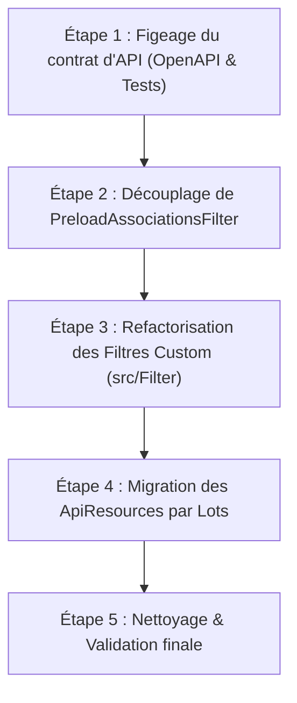

# Plan de Migration : Dépréciation et Remplacement de `ApiFilter` (API Platform)

## 1. Contexte & Cycle de Vie API Platform

Dans les versions récentes d'API Platform (4.2+, 4.3 et 5.0) :
- L'attribut `#[ApiFilter]`, la propriété `Operation::$filters` ainsi que la classe de base `ApiPlatform\Doctrine\Orm\Filter\AbstractFilter` sont **dépréciés** au profit d'une déclaration granulaire via l'attribut `#[QueryParameter]` et l'interface `ApiPlatform\Doctrine\Orm\Filter\FilterInterface`.
- Bien que le retrait définitif du code historique soit planifié pour API Platform **6.0**, la branche **5.0** introduit des contraintes strictes :
  - L'attribut `property` devient obligatoire sur les filtres Doctrine paramétrés (exception levée sinon).
  - `RangeFilter` est déprécié au profit de `ComparisonFilter(new ExactFilter())`.
  - Des dépréciations sont déclenchées lors de l'usage des filtres historiques.
- Le projet étant actuellement sous **API Platform 4.3.5** et PHP 8.4, cette migration permet d'assainir la codebase, de supprimer la dette technique et de préparer une transition transparente vers les futures versions majeures.

---

## 2. État des Lieux dans le Projet (`esup-oasis/backend`)

Le projet compte **156 occurrences** de `ApiFilter` réparties entre filtres natifs et filtres personnalisés.

### Répartition des filtres natifs API Platform

| Filtre hérité | Occurrences | Remplacement moderne recommandé | Notes |
| :--- | :--- | :--- | :--- |
| `SearchFilter` | 12 | `PartialSearchFilter` / `ExactFilter` / `IriFilter` | Dépend de la stratégie (`exact`, `ipartial`, etc.) |
| `OrderFilter` | 7 | `SortFilter` | Syntaxe URL conservée (`order[champ]=asc`) |
| `BooleanFilter` | 5 | `ExactFilter` | Géré nativement par `ExactFilter` |
| `DateFilter` | 6 | `DateFilter` (conservé) | Même classe, mais instanciée dans un `#[QueryParameter]` |
| `ExistsFilter` | 5 | `ExistsFilter` (conservé) | Même classe, mais instanciée dans un `#[QueryParameter]` |

### Répartition des filtres personnalisés (`src/Filter/*`)

Une quarantaine de filtres métier étendent actuellement `AbstractFilter` :
- **Filtres génériques très utilisés :**
  - `CaseInsensitiveOrderFilter` (22 usages)
  - `NestedUtilisateurFilter` (6 usages)
  - `NomIntervenantFilter` (2 usages)
  - `NestedFieldSearchFilter` (2 usages)
  - `BeneficiaireActifTagFilter` (2 usages)
  - `ComposanteFormationFilter` (2 usages)
- **Filtres métier spécialisés (~25 filtres) :**
  - `BeneficiaireFilter`, `IntervenantFilter`, `RenfortFilter`, `EvenementsAValiderFilter`, etc.
- **Cas particulier architectural :**
  - `PreloadAssociationsFilter` (7 usages) : ce filtre n'est pas un paramètre d'URL utilisateur mais une "tambouille interne" alimentée via `$context['filters']` dans les State Providers (`ComposanteProvider`, `DemandeProvider`, etc.).

---

## 3. Plan d'Action par Étapes



---

### Étape 1 : Figeage du contrat d'API & Validation de référence

Avant toute modification :
1. **Sauvegarder l'état actuel de la documentation OpenAPI** pour détecter toute régression de contrat avec le frontend :
   ```bash
   php bin/console api:openapi:export --yaml > openapi_baseline.yaml
   ```
2. **Exécuter la suite de tests complète** pour s'assurer du bon fonctionnement initial :
   ```bash
   vendor/bin/phpunit
   ```

---

### Étape 2 : Découplage de `PreloadAssociationsFilter`

#### Analyse
`PreloadAssociationsFilter` est actuellement déclaré via `#[ApiFilter(PreloadAssociationsFilter::class)]` sur plusieurs ressources (`Composante`, `Demande`, `Evenement`, `Utilisateur`, etc.), mais aucun client d'API n'envoie de paramètre `?preloadAssociations=...`. Les providers injectent cette configuration dans `$context['filters']` pour forcer des jointures `leftJoin()` / `addSelect()`.

Avec `ParameterExtension`, un filtre n'est déclenché que si le paramètre associé est présent dans la requête (`$parameter->getValue()`).

#### Action
1. Extraire la logique de préchargement d'associations :
   - Soit sous forme d'une `QueryCollectionExtensionInterface` Doctrine dédiée recevant des directives via le contexte.
   - Soit sous forme d'un service utilitaire (helper) directement appelé par les State Providers sur le `QueryBuilder`.
2. Supprimer les déclarations `#[ApiFilter(PreloadAssociationsFilter::class)]` sur les ApiResources.
3. Supprimer ou déprécier `PreloadAssociationsFilter`.

---

### Étape 3 : Refactorisation des Filtres Personnalisés (`src/Filter/*`)

Tous les filtres personnalisés doivent migrer du modèle `AbstractFilter` vers l'interface moderne `FilterInterface`.

#### Modèle cible pour un filtre personnalisé

1. **Supprimer l'héritage** de `ApiPlatform\Doctrine\Orm\Filter\AbstractFilter`.
2. **Implémenter** `ApiPlatform\Doctrine\Orm\Filter\FilterInterface`.
3. **Remplacer** `filterProperty()` par la méthode `apply()`.
4. Récupérer la valeur du paramètre via `$context['parameter']->getValue()`.
5. Utiliser temporairement le trait `BackwardCompatibleFilterDescriptionTrait` pour garantir la compatibilité ascendante le temps de migrer l'ensemble des ressources.
6. Pour l'exposition OpenAPI et la validation, implémenter `JsonSchemaFilterInterface` ou utiliser `OpenApiFilterTrait`.

#### Exemple : Avant / Après

**Avant (Hérité) :**
```php
namespace App\Filter;

use ApiPlatform\Doctrine\Orm\Filter\AbstractFilter;
use ApiPlatform\Doctrine\Orm\Util\QueryNameGeneratorInterface;
use ApiPlatform\Metadata\Operation;
use Doctrine\ORM\QueryBuilder;

class MonFiltre extends AbstractFilter
{
    protected function filterProperty(
        string $property,
        $value,
        QueryBuilder $queryBuilder,
        QueryNameGeneratorInterface $queryNameGenerator,
        string $resourceClass,
        ?Operation $operation = null,
        array $context = [],
    ): void {
        if ($property !== 'monParametre') {
            return;
        }

        $alias = $queryBuilder->getRootAliases()[0];
        $queryBuilder->andWhere(sprintf('%s.actif = :val', $alias))
                     ->setParameter('val', $value);
    }

    public function getDescription(string $resourceClass): array
    {
        return [/* ... */];
    }
}
```

**Après (Moderne) :**
```php
namespace App\Filter;

use ApiPlatform\Doctrine\Orm\Filter\FilterInterface;
use ApiPlatform\Doctrine\Orm\Util\QueryNameGeneratorInterface;
use ApiPlatform\Metadata\BackwardCompatibleFilterDescriptionTrait;
use ApiPlatform\Metadata\Operation;
use Doctrine\ORM\QueryBuilder;

final class MonFiltre implements FilterInterface
{
    use BackwardCompatibleFilterDescriptionTrait; // Pour rétrocompatibilité transitoire

    public function apply(
        QueryBuilder $queryBuilder,
        QueryNameGeneratorInterface $queryNameGenerator,
        string $resourceClass,
        ?Operation $operation = null,
        array $context = []
    ): void {
        $parameter = $context['parameter'] ?? null;
        if (null === $parameter) {
            return;
        }

        $value = $parameter->getValue();
        if (null === $value) {
            return;
        }

        $alias = $queryBuilder->getRootAliases()[0];
        $paramName = $queryNameGenerator->generateParameterName('actif');
        
        $queryBuilder->andWhere(sprintf('%s.actif = :%s', $alias, $paramName))
                     ->setParameter($paramName, $value);
    }
}
```

---

### Étape 4 : Migration des `ApiResource` par Lots

Pour chaque ressource, les filtres ne doivent plus être déclarés au niveau classe via `#[ApiFilter]`, mais attachés à l'opération de collection (`GetCollection`) via l'argument `parameters: [...]`.

#### Exemple d'équivalence de syntaxe

**Avant :**
```php
#[ApiResource]
#[ApiFilter(SearchFilter::class, properties: ['libelle' => 'ipartial'])]
#[ApiFilter(BooleanFilter::class, properties: ['actif'])]
#[ApiFilter(DateFilter::class, properties: ['debut', 'fin'])]
#[ApiFilter(CaseInsensitiveOrderFilter::class, properties: ['libelle'])]
class TypeAmenagement { ... }
```

**Après :**
```php
use ApiPlatform\Doctrine\Orm\Filter\ExactFilter;
use ApiPlatform\Doctrine\Orm\Filter\PartialSearchFilter;
use ApiPlatform\Doctrine\Orm\Filter\DateFilter;
use ApiPlatform\Metadata\GetCollection;
use ApiPlatform\Metadata\QueryParameter;

#[ApiResource(
    operations: [
        new GetCollection(
            parameters: [
                'libelle' => new QueryParameter(
                    filter: new PartialSearchFilter(),
                    property: 'libelle',
                ),
                'actif' => new QueryParameter(
                    filter: new ExactFilter(),
                    property: 'actif',
                ),
                'debut' => new QueryParameter(
                    filter: new DateFilter(),
                    property: 'debut',
                ),
                'fin' => new QueryParameter(
                    filter: new DateFilter(),
                    property: 'fin',
                ),
                'order[:property]' => new QueryParameter(
                    filter: new CaseInsensitiveOrderFilter(), // ou new SortFilter()
                    properties: ['libelle'],
                ),
            ]
        ),
        // ... conserver les autres opérations (Get, Post, Patch, etc.)
    ]
)]
class TypeAmenagement { ... }
```

#### Découpage par lots progressifs

| Lot | Cibles | Justification / Objectif |
| :--- | :--- | :--- |
| **Lot 1 : Référentiels simples** | `Tag`, `CategorieTag`, `TypeEquipement`, `DisciplineArtistique`, `TypeAmenagement`, `EtablissementEnseignementArtistique` | Peu de dépendances, tests rapides, permet de valider le pattern sur les tris et filtres simples. |
| **Lot 2 : Ressources intermédiaires** | `Composante`, `CampagneDemande`, `TauxHoraire`, `PeriodeRH`, `ServicesFaits`, `Entretien`, `BeneficiaireProfil` | Prise en main des filtres avec dates et intervalles. |
| **Lot 3 : Événements & Aménagements** | `Amenagement`, `Evenement`, `ActiviteBeneficiaire`, `ActiviteIntervenant` | Validation des relations imbriquées (syntaxe avec notation pointée `beneficiaires.utilisateur`). |
| **Lot 4 : Ressource centrale `Utilisateur`** | `Utilisateur` | 26 filtres déclarés. Nécessite une attention particulière sur les filtres de rôle (`BeneficiaireFilter`, `IntervenantFilter`, etc.). |

---

### Étape 5 : Nettoyage & Contrôles Qualité

1. **Suppression du code obsolète :**
   - Retirer tous les imports inutilisés `use ApiPlatform\Metadata\ApiFilter;`.
   - Supprimer le trait `BackwardCompatibleFilterDescriptionTrait` une fois toutes les ressources migrées.
   - Supprimer les méthodes `getDescription()` résiduelles.
2. **Vérification de la non-régression du contrat OpenAPI :**
   ```bash
   php bin/console api:openapi:export --yaml > openapi_migrated.yaml
   diff -u openapi_baseline.yaml openapi_migrated.yaml
   ```
   *Vérifier qu'aucun nom de paramètre ou format attendu par le frontend n'a été altéré.*
3. **Validation de la suite de tests :**
   ```bash
   vendor/bin/phpunit
   ```
4. **Formatage et analyse statique :**
   ```bash
   mago format
   mago lint
   ```

---

## 4. Bonnes Pratiques & Pièges à Éviter

1. **Arguments nommés dans les filtres :**
   Lors de l'instanciation d'un filtre dans un attribut (ex: `filter: new DateFilter(nullManagement: ...)`), utilisez toujours des arguments nommés pour assurer la compatibilité ascendante avec les évolutions de constructeurs.
2. **Propriété explicite obligatoire en 5.0+ :**
   Tout `QueryParameter` utilisant un filtre Doctrine doit comporter l'argument `property: 'nomDuChamp'` ou le placeholder `:property` dans sa clé (ex: `'order[:property]'`).
3. **Alerte cache warmup (#7361) :**
   L'instanciation directe `new DateFilter()` dans un attribut peut produire une alerte cosmétique au `cache:clear`. Référencer le filtre par son ID de service (ex: `'api_platform.doctrine.orm.date_filter'`) ou via un `ChainFilter` supprime ce message si souhaité.
4. **Propriétés imbriquées (relations Doctrine) :**
   Avec `QueryParameter`, la notation pointée est gérée nativement pour les jointures (ex: `property: 'beneficiaires.utilisateur'`).

---

## 5. Journal d'Avancement & Reprise (État au 19/10/2026)

### ✅ Terminés & Validés
1. **Infrastructure & Helpers :**
   - `src/Filter/Util/IriToIdResolver.php` : Résolution robuste d'IRIs et d'identifiants numériques sans dépendre de l'entité Doctrine sous-jacente.
   - `src/Filter/ResourceIriFilter.php` : Filtre moderne supportant les valeurs scalaires et collections (`prop[]`), avec résolution dynamique des jointures imbriquées (`resolveTargetAliasAndField`). Validé Mago (0 issue).
   - `src/Filter/InscriptionEnCoursFilter.php` : Modernisé sans `AbstractFilter`.
   - `src/Doctrine/Extension/PeriodeDansIntervalleExtension.php` : Remplacement complet de `PeriodeDansIntervalleFilter` (supprimé).
   - `src/Filter/BilanFinancierProfilBeneficiairesFilter.php` : Modernisé avec `FilterInterface` et `IriToIdResolver`.
2. **Ressources migrées & testées :**
   - Référentiels simples (Lot 1) : `Tag`, `CategorieTag`, `TypeEquipement`, `DisciplineArtistique`, `TypeAmenagement`, etc.
   - Ressources intermédiaires (Lot 2) : `Composante`, `CampagneDemande`, `TauxHoraire`, `PeriodeRH`, `ServicesFaits`, `Entretien`, `BeneficiaireProfil`, etc.
   - `Formation` : 100% migré et testé (`SiScolTest`).
   - `BilanActivite` : 100% migré, testé (`BilanActiviteTest`, 6 tests verts).
   - `BilanFinancier` : 100% migré, testé (`BilanFinancierTest`, 3 tests verts).

### ⏳ En cours / À reprendre immédiatement
1. **Modernisation de `src/Filter/ActivitePeriodeFilter.php`** :
   - Remplacer l'héritage `AbstractFilter` par `FilterInterface`, `JsonSchemaFilterInterface`, `OpenApiParameterFilterInterface`.
   - Utiliser `IriToIdResolver` pour `InterventionForfait` et conserver la logique de période fermée/ouverte pour `Evenement`.
2. **Migration de `ActiviteBeneficiaire` & `ActiviteIntervenant`** :
   - `src/ApiResource/ActiviteBeneficiaire.php` : Remplacer `#[ApiFilter]` par les `parameters:` sur `GetCollection` :
     - `type` (`ResourceIriFilter`)
     - `campus` (`ResourceIriFilter`)
     - `beneficiaires.profil` (`ResourceIriFilter`)
     - `beneficiaires.typologies` (`ResourceIriFilter`)
     - `beneficiaires` (`NestedUtilisateurFilter`)
     - `debut`, `fin` (`DateFilter`)
     - `exists[dateAnnulation]` (`ExistsFilter`)
     - `periode` (`ActivitePeriodeFilter`)
   - `src/ApiResource/ActiviteIntervenant.php` : De même pour `type`, `campus`, `intervenant`, `debut`, `fin`, `exists[intervenant]`, `exists[dateAnnulation]`, `periode`.
   - Valider avec `tests/BilansTest.php`.
3. **Ressources restantes :**
   - `InterventionForfait.php` & `Evenement.php` (Lot 3)
   - `Demande.php` & `Amenagement.php`
   - `Utilisateur.php` (Lot 4)
4. **Validation globale :**
   - `diff -u openapi_baseline.yaml openapi_migrated.yaml`
   - `vendor/bin/phpunit`
   - `mago format` & `mago lint`

