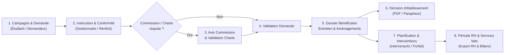
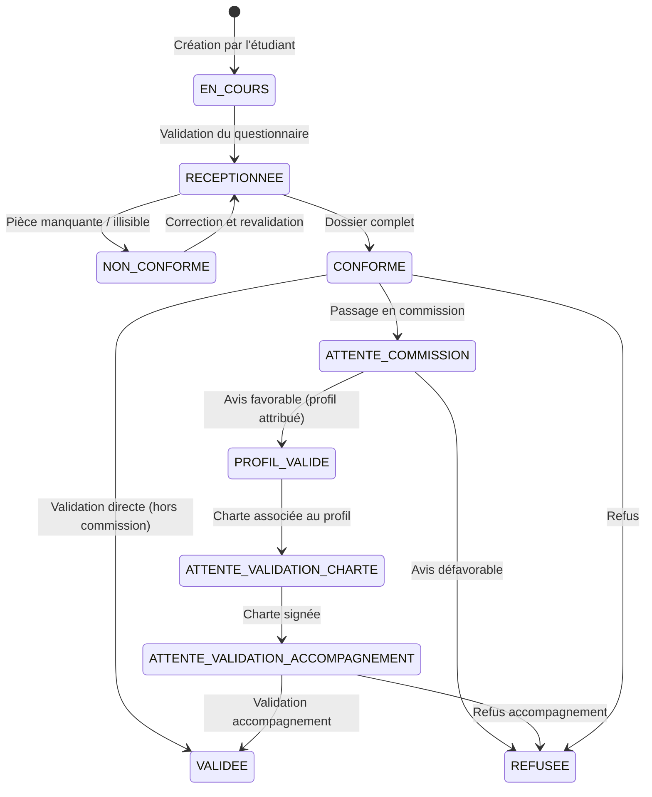

# Documentation fonctionnelle — ESUP-Oasis

> **Historique des révisions**
>
> | Version | Date       | Commentaires                                                                                                                                                                                                                                                                         |
> |---------|------------|--------------------------------------------------------------------------------------------------------------------------------------------------------------------------------------------------------------------------------------------------------------------------------------|
> | 1.0     | 21/10/2024 | Reprise des documentations LOT 1 et LOT 2 en une seule documentation fonctionnelle (Expression de besoins initiale, Université de Bordeaux — Service PHASE)                                                                                                                          |
> | 2.4     | 17/11/2026 | Conversion en Markdown et mise à jour complète selon l'état applicatif d'ESUP-Oasis (v2.4+ : nouveaux statuts de demandes, onglet Décision d'établissement & signature électronique/parapheur, filtres de validité, accessibilité, mode sombre, FullCalendar, bilans et paramétrage) |

---

## Table des matières

1. [Cadre général du projet](#1-cadre-général-du-projet)
    - [1.1 Contexte](#11-contexte)
    - [1.2 Objectifs et bénéfices attendus](#12-objectifs-et-bénéfices-attendus)
    - [1.3 Périmètre fonctionnel](#13-périmètre-fonctionnel)
    - [1.4 Interopérabilité et briques externes](#14-interopérabilité-et-briques-externes)
2. [Processus macro](#2-processus-macro)
3. [Accès, interface et habilitations](#3-accès-interface-et-habilitations)
    - [3.1 Connexion, accessibilité et personnalisation](#31-connexion-accessibilité-et-personnalisation)
    - [3.2 Tableau de bord](#32-tableau-de-bord)
    - [3.3 Utilisateurs et rôles](#33-utilisateurs-et-rôles)
    - [3.4 Administration de l'application — Référentiels](#34-administration-de-lapplication--référentiels)
        - [3.4.1 Administration / Utilisateurs](#341-administration--utilisateurs)
        - [3.4.2 Administration / Demandes](#342-administration--demandes)
        - [3.4.3 Administration / Bénéficiaires](#343-administration--bénéficiaires)
        - [3.4.4 Administration / Intervenants](#344-administration--intervenants)
        - [3.4.5 Administration / Planification & RH](#345-administration--planification--rh)
        - [3.4.6 Administration / Paramètres de l'application](#346-administration--paramètres-de-lapplication)
4. [Gestion des demandes](#4-gestion-des-demandes)
    - [4.1 Processus de demande de statut et d'accompagnement](#41-processus-de-demande-de-statut-et-daccompagnement)
    - [4.2 Questionnaire de demande d'accompagnement](#42-questionnaire-de-demande-daccompagnement)
    - [4.3 Gestion des statuts, commissions, chartes et mails](#43-gestion-des-statuts-commissions-chartes-et-mails)
    - [4.4 Gestion des dossiers demandeurs](#44-gestion-des-dossiers-demandeurs)
5. [Gestion des bénéficiaires](#5-gestion-des-bénéficiaires)
    - [5.1 Bénéficiaires : vue individuelle](#51-bénéficiaires--vue-individuelle)
    - [5.2 Bénéficiaires : vues globales et aménagements](#52-bénéficiaires--vues-globales-et-aménagements)
6. [Gestion des interventions et planning](#6-gestion-des-interventions-et-planning)
    - [6.1 Profils intervenants](#61-profils-intervenants)
    - [6.2 Planning des interventions](#62-planning-des-interventions)
    - [6.3 Interventions au forfait](#63-interventions-au-forfait)
    - [6.4 Renforts étudiants et validation des heures](#64-renforts-étudiants-et-validation-des-heures)
    - [6.5 Écrans spécifiques intervenants](#65-écrans-spécifiques-intervenants)
    - [6.6 Écrans spécifiques bénéficiaires](#66-écrans-spécifiques-bénéficiaires)
7. [Indicateurs, bilans et suivis RH](#7-indicateurs-bilans-et-suivis-rh)
    - [7.1 Envoi des services faits à la RH](#71-envoi-des-services-faits-à-la-rh)
    - [7.2 Bilan financier d'aide humaine](#72-bilan-financier-daide-humaine)
    - [7.3 Suivi d'activités : vue bénéficiaire](#73-suivi-dactivités--vue-bénéficiaire)
    - [7.4 Suivi d'activités : vue intervenant](#74-suivi-dactivités--vue-intervenant)
    - [7.5 Bilan d'activités](#75-bilan-dactivités)
    - [7.6 Traitements automatisés et anonymisation](#76-traitements-automatisés-et-anonymisation)

---

## 1. Cadre général du projet

### 1.1 Contexte

**ESUP-Oasis** (*Outil pour l'Accompagnement et le Suivi Individualisé des étudiants à besoins Spécifiques*) est une
application dédiée à la gestion des étudiants nécessitant un aménagement de leur scolarité et un accompagnement
personnalisé dans l'enseignement supérieur. Initialement développée par la DSI de l'université de Bordeaux pour son
service **PHASE**, elle est paramétrable pour tout établissement (nom du service, libellé des décisions, espace santé,
logos, activation ou non du module de demandes).

Les profils concernés incluent notamment :

- Les étudiants en situation de handicap ou de maladie invalidante (permanente ou temporaire) ;
- Les étudiants sportifs de haut et bon niveau ;
- Les artistes confirmés ;
- D'autres profils selon les critères de l'établissement (engagés, élus, salariés, entrepreneurs, chargés de famille,
  femmes enceintes, doubles cursus, etc.).

Les aménagements mis en place couvrent trois grands domaines :

- **Aménagements pédagogiques** : adaptation des cursus, étalement, dispense d'assiduité, soutien pédagogique,
  enseignants relais, mise à disposition de contenus de cours, etc. ;
- **Aides humaines** : interprétariat en langue des signes (LSF), codage LPC, transcription écrite simultanée, prise de
  notes, tutorat, secrétariat d'épreuve, etc. ;
- **Aménagements d'examens** : temps majoré, assistance de secrétaire, adaptation des supports, prêt de matériel
  spécifique, report ou session d'examens différés, etc.

### 1.2 Objectifs et bénéfices attendus

- Disposer d'un outillage unique, adapté et fiable pour le suivi des étudiants accompagnés et la gestion des
  interventions (emplois étudiants / intervenants).
- Assurer la **sécurisation des données** personnelles et médicales (cloisonnement des droits, stockage sécurisé des
  pièces, analyse antivirus, anonymisation).
- Lever le risque juridique lié aux décisions d'aménagements (traçabilité, mention optionnelle de la date d'avis
  médical, signature électronique).
- Apporter un **gain de temps** important dans l'activité des équipes (instruction dématérialisée des demandes,
  planification, génération automatique des décisions et des relevés RH).

### 1.3 Périmètre fonctionnel

L'application couvre l'ensemble du cycle d'accompagnement sur une année universitaire (du 1er septembre au 31 août) :

1. **Gestion des demandes** *(activable/désactivable via `REACT_APP_GERER_DEMANDES`)* :
    - Campagnes paramétrables avec dates d'ouverture, de fermeture, d'archivage et année universitaire cible.
    - Questionnaires dynamiques par type de demande et dépôt de pièces justificatives.
    - Instruction par les gestionnaires, renforts habilités et commissions (avec cloisonnement des profils sensibles),
      signature de chartes en ligne.
2. **Gestion des bénéficiaires** :
    - Fiche individuelle multi-onglets (identité, demandes, aménagements par domaine, décision d'établissement et
      signature électronique, avis santé/ESE, synthèses d'entretiens, documents).
    - Vues globales et exports CSV filtrables (par validité de profil, tags, composantes, aménagements, etc.).
3. **Gestion des interventions et planification** :
    - Gestion des intervenants (compétences, campus, catégories d'événements, périodes de validité).
    - Planning calendrier et liste des interventions, interventions au forfait, saisie et validation des heures de
      renforts.
4. **Suivi RH, indicateurs et bilans** :
    - Périodes RH, relevés mensuels de services faits (intervenants et export RH), bilan financier et bilans
      d'activités.

### 1.4 Interopérabilité et briques externes

ESUP-Oasis s'interface avec plusieurs briques du système d'information :

- **Scolarité (Apogée / SI Scol)** : récupération et mise à jour périodique des données administratives et inscriptions
  des étudiants.
- **Annuaire (LDAP) et Authentification (CAS / OAuth2 / OIDC)** : identification des utilisateurs et synchronisation des
  comptes.
- **Photos étudiantes (ex. UniCampus)** : récupération sécurisée des photos de profil.
- **Stockage de fichiers (Nuxeo ou stockage local)** et **antivirus (ClamAV)** : analyse et conservation des pièces
  justificatives.
- **Génération PDF (Gotenberg)** : édition des décisions d'établissement et des relevés de services faits.
- **Parapheur électronique (ex. FAST-Parapheur)** *(optionnel)* : circuit de signature électronique des décisions
  d'établissement par composante.
- **Messagerie / Calendrier** : notifications par courriel et synchronisation iCalendar (`MesCalendriers` ou
  équivalent).

---

## 2. Processus macro

Le cycle complet, de la demande initiale de l'étudiant jusqu'au suivi des interventions et à la paie RH, s'articule de
la manière suivante :

---

## 3. Accès, interface et habilitations

### 3.1 Connexion, accessibilité et personnalisation

- **Authentification** : La connexion des utilisateurs s'effectue via **OAuth2 / OIDC** (testé avec CAS OAuth). Une
  authentification par clé d'API est également disponible pour les applications clientes externes (accès restreint aux
  événements).
- **Accessibilité (RGAA / WCAG)** :
    - Lien d'évitement (*Aller au contenu principal*) en haut de page.
    - Menu d'accessibilité dédié dans l'en-tête permettant d'activer :
        - Un mode **contraste élevé** ;
        - Des polices adaptées aux troubles dyslexiques (*Lexend*, *Arial*, *OpenDys*) ;
        - Une **police élargie** (*Police large*).
    - Ces préférences sont persistées en base de données par utilisateur.
- **Mode sombre (bêta)** : Lorsqu'il est activé (`REACT_APP_DARKMODE`), l'utilisateur peut choisir entre *Mode clair*,
  *Mode sombre* ou *Identique au système*.
- **Visite guidée** : Activée via `REACT_APP_VISITE_GUIDEE`, elle accompagne les demandeurs lors de la prise en main de
  leur dossier.
- **Personnalisation établissement** : Logos clair/sombre, couleur principale, mentions légales, libellé des décisions
  (`REACT_APP_DECISION_ETAB_LIB`), libellé de l'espace santé (`REACT_APP_ESPACE_SANTE`) et libellés des menus sont
  configurables.

### 3.2 Tableau de bord

L'écran d'accueil après connexion s'adapte au rôle de l'utilisateur :

- **Administrateurs, Gestionnaires (CAS) et Renforts** :
    - Vue synthétique de l'activité du service (nombre de bénéficiaires, d'aménagements en cours, d'intervenants,
      profils restant à déterminer, avis santé en attente, décisions à valider ou à éditer) ;
    - Avancement des demandes d'accompagnement par état (si le module Demandes est actif) ;
    - Statistiques de planification des événements (jour, semaine, mois : taux d'affectation, interventions de renforts
      à valider, alerte sur les événements sans bénéficiaire) ;
    - Barre de recherche globale (accès rapide à un demandeur, bénéficiaire ou intervenant) et cloche de notifications.
- **Demandeurs** : Redirigés vers la vue **Mes demandes** (`/demandes`).
- **Bénéficiaires** : Tableau de bord intégrant leur **planning** et une alerte de complétude de profil.
- **Intervenants** : Tableau de bord dédié affichant les événements à venir/passés, la période RH en cours avec sa date
  butoir, et les relevés de services faits.
- **Référents de composante** : Redirigés vers la vue **Aménagements** filtrée sur leur(s) composante(s).

### 3.3 Utilisateurs et rôles

Les habilitations reposent sur une hiérarchie de rôles gérée côté serveur et traduite dans les menus applicatifs :

| Rôle applicatif                                  | Code technique             | Périmètre et droits principaux                                                                                                                                                                                                                                            |
|--------------------------------------------------|----------------------------|---------------------------------------------------------------------------------------------------------------------------------------------------------------------------------------------------------------------------------------------------------------------------|
| **Administrateur**                               | `ROLE_ADMIN`               | Tous les droits fonctionnels, accès complet à l'Administration (référentiels, paramètres, signature électronique), édition/envoi des décisions d'établissement, bilans RH/financiers/activités, impersonation (`/impersonate/:uid`).                                      |
| **Chargé d'accompagnement / Gestionnaire (CAS)** | `ROLE_GESTIONNAIRE`        | Gestion des demandes, gestion complète des dossiers bénéficiaires, demande d'édition des décisions, gestion des intervenants, planification, validation des interventions des renforts, suivis d'activités.                                                               |
| **Renfort étudiant**                             | `ROLE_RENFORT`             | Planification des événements, gestion des intervenants, saisie de ses propres interventions (*Mes interventions*), consultation restreinte des aménagements (hors profils handicap et hors types masqués aux renforts) et des demandes (hors types à visibilité limitée). |
| **Intervenant**                                  | `ROLE_INTERVENANT`         | Consultation de son planning (calendrier/liste), gestion de son profil (coordonnées, compétences, campus, préférences de notifications, synchro calendrier), consultation de ses services faits.                                                                          |
| **Bénéficiaire**                                 | `ROLE_BENEFICIAIRE`        | Consultation de son planning, gestion de son profil (coordonnées, préférences de notifications, synchro calendrier), accès à ses demandes.                                                                                                                                |
| **Demandeur**                                    | `ROLE_DEMANDEUR`           | Dépôt et suivi de ses demandes d'accompagnement, modification en cas de non-conformité, validation de charte.                                                                                                                                                             |
| **Membre de commission**                         | `ROLE_MEMBRE_COMMISSION`   | Consultation des demandes rattachées à sa/ses commission(s), avec droits configurables : validation de conformité (`ROLE_VALIDER_CONFORMITE_DEMANDE`) et/ou attribution de profil (`ROLE_ATTRIBUER_PROFIL`).                                                              |
| **Référent de composante**                       | `ROLE_REFERENT_COMPOSANTE` | Consultation des aménagements des bénéficiaires rattachés à sa/ses composante(s) (vue *Aménagements par bénéficiaire*).                                                                                                                                                   |

### 3.4 Administration de l'application — Référentiels

Accessible uniquement aux **Administrateurs** (`ROLE_ADMIN`) via le menu utilisateur *Administration*, cet espace permet
de paramétrer l'application en autonomie, sans intervention technique. Il est organisé en 6 thématiques.

#### 3.4.1 Administration / Utilisateurs

- **Bureaux** (`/services`) : Gestion des bureaux ou périmètres d'activité du service d'accompagnement (création,
  activation/désactivation) auxquels sont rattachés les gestionnaires et les bénéficiaires.
- **Utilisateurs** : Ajout, recherche (par nom, rôle ou bureau) et gestion des utilisateurs internes (administrateurs,
  chargés d'accompagnement, renforts).
- **Référents** : Attribution du rôle de référent de composante à un utilisateur sur une ou plusieurs composantes pour
  lui permettre de consulter les aménagements des bénéficiaires concernés.

#### 3.4.2 Administration / Demandes

*(Section masquée lorsque `REACT_APP_GERER_DEMANDES=false`.)*

- **Campagnes de demandes** : Paramétrage des campagnes rattachées à un type de demande. Chaque campagne définit :
    - Un libellé, une date d'ouverture et une date de fermeture (hors de cette plage, le questionnaire n'est plus
      saisissable par les étudiants mais reste modifiable par les gestionnaires) ;
    - Une **année cible** (année universitaire sur laquelle le bénéficiaire sera créé) ;
    - Une **commission** et une date de commission éventuelles ;
    - Une **date d'archivage** permettant de basculer automatiquement à J+1 les demandes restées *En cours* ou *Non
      conformes* vers l'état *Refusée*.
    - Un onglet **« Toutes les campagnes »** permet aux administrateurs de consulter en lecture seule l'ensemble des
      campagnes d'un type de demande.
    - *Note* : La structure des types de demandes et des questionnaires est définie en base/YAML (initialisable via la
      commande CLI `app:init-questionnaire`), et non créée depuis l'interface.
- **Commissions** : Création, activation/désactivation des commissions et gestion de leurs membres (avec attribution
  fine des droits : valider la conformité et/ou attribuer un profil).
- **Chartes** : Rédaction des chartes (ex. chartes sportifs SHN/TBN et BN) et association aux profils bénéficiaires
  concernés.
- **Disciplines sportives**, **Clubs sportifs** (centres de formation labellisés et clubs professionnels), **Disciplines
  artistiques**, **Établissements d'enseignement artistique** : Référentiels alimentant les listes déroulantes des
  questionnaires correspondants.
- **Sportifs de haut niveau** : Import ou saisie manuelle des sportifs inscrits sur les listes ministérielles (Nom,
  Prénom, Année de naissance, N° PSQS) afin de permettre la reconnaissance et la validation automatique de leur statut
  lors du dépôt de demande.

#### 3.4.3 Administration / Bénéficiaires

- **Profils** : Gestion des profils étudiants bénéficiaires (activation/désactivation). Pour les profils portant une
  typologie de handicap, une option **« Avis médical requis pour éditer la décision d'établissement »** permet d'imposer
  la saisie de la date d'avis médical avant toute demande d'édition ou envoi de décision.
- **Typologies de handicap** : Sous-ensemble associé aux profils de handicap (permanent/temporaire), utilisé pour le
  suivi et les bilans.
- **Aménagements** : Paramétrage des catégories et types d'aménagements répartis dans les 3 domaines (*Aménagements
  pédagogiques*, *Aides humaines*, *Aménagements d'examens*), avec possibilité de définir les libellés longs utilisés
  dans les décisions et la visibilité pour les renforts.
- **Aménagements : Suivi mise en place** : Liste des états de suivi de mise en œuvre d'un aménagement (ex. à faire, en
  cours, mis en place), facilitant la coordination entre chargés d'accompagnement et renforts.
- **Tags** : Catégories de tags et libellés libres apposés sur les dossiers bénéficiaires pour faciliter le filtrage et
  les exports.

#### 3.4.4 Administration / Intervenants

- **Compétences** : Ajout et activation/désactivation des compétences des intervenants (utilisées lors de la recherche
  d'intervenant dans le planning).

#### 3.4.5 Administration / Planification & RH

- **Catégories d'événements** : Paramétrage des types d'événements avec :
    - Libellé, couleur d'affichage dans le calendrier, activation ;
    - Visibilité par défaut dans le planning calendrier (`visibleParDefaut`) ;
    - Caractère forfaitaire (`forfait`, ex. prise de notes) ou soumis à validation (`avecValidation`, ex. renforts) ;
    - **Taux horaires historisés** par période, garantissant l'exactitude des montants lors des exports RH et bilans.
- **Campus** : Implantations géographiques associées aux intervenants et événements.
- **Équipements** : Types d'équipements mobilisables lors des événements (notamment les épreuves/examens).
- **Périodes RH** : Saisie des plages mensuelles transmises par le service RH, comprenant une **date butoir** (au-delà
  de laquelle les événements passés sont verrouillés pour les non-administrateurs) et une **date d'envoi RH**.

#### 3.4.6 Administration / Paramètres de l'application

- **Paramètres** : Gestion de constantes applicatives historisées par date de début/fin :
    - `COEFFICIENT_CHARGES` : coefficient utilisé pour calculer le coût chargé dans les bilans ;
    - `EXPEDITEUR_EMAILS`, `SERVICE_NOM` ;
    - `PRESIDENT_NOM`, `PRESIDENT_QUALITE`, `RESPONSABLE_PHASE_NOM`, `RESPONSABLE_PHASE_QUALITE`, `SIGNATURE_DECISIONS`
      (utilisés dans les décisions d'établissement) ;
    - Fréquences de rappels (`FREQUENCE_RAPPELS`, `FREQUENCE_RAPPEL_ENVOI_RH`, `RAPPELS_SANS_INTERVENANTS`) et de mise à
      jour des inscriptions (`FREQUENCE_MAJ_INSCRIPTIONS`) ;
    - `CONST_INFOS_COMPLEMENTAIRES` : champs complémentaires affichables sur les fiches et tableaux bénéficiaires.
- **Menus** : Personnalisation des libellés du menu principal avec aperçu en direct.
- **Signature électronique** *(visible uniquement si `REACT_APP_PARAPHEUR` est configuré)* :
    - Affichage du parapheur connecté (ex. FAST-Parapheur) ;
    - Paramétrage de la fréquence de suivi des signatures ;
    - Configuration des **circuits de signature par composante** utilisés lors de l'envoi des décisions d'établissement.

---

## 4. Gestion des demandes

*(Ce module peut être désactivé globalement via `REACT_APP_GERER_DEMANDES=false`.)*

### 4.1 Processus de demande de statut et d'accompagnement

Pour entrer dans le dispositif, l'étudiant se connecte à ESUP-Oasis et dépose une demande sur une **campagne ouverte**.
Un étudiant multi-profils doit effectuer une demande par campagne correspondante.

En dehors des dates d'ouverture d'une campagne, l'étudiant ne peut plus saisir ni modifier son questionnaire, mais les
chargés d'accompagnement conservent la possibilité d'intervenir sur le dossier pour traiter les cas particuliers. Une
demande peut également être ajoutée directement depuis le profil d'un bénéficiaire existant.

### 4.2 Questionnaire de demande d'accompagnement

Le questionnaire est structuré en étapes paramétrables (avec squelette de chargement et visite guidée optionnelle) :

1. **Page d'accueil (/demandes)** : Visualisation des demandes déjà initiées, suivi de leur avancement et bouton *«
   Déposer une nouvelle demande »* listant les campagnes ouvertes à la date du jour.
2. **Informations générales du demandeur** : Coordonnées non issues du SI Scol (téléphone, courriel personnel, contact
   d'urgence). En cas de demandes multiples ou de renouvellement, les réponses marquées comme conservables
   (`reponseConservable`) sont pré-remplies automatiquement.
3. **Questions spécifiques liées au profil** : Questions conditionnelles et listes dynamiques issues des référentiels
   (typologies de handicap, N° PSQS et discipline/club pour les sportifs, discipline/établissement pour les artistes,
   type d'engagement, contrat salarié/entrepreneur, grossesse, etc.).
4. **Situation, contraintes et aménagements souhaités** : Si l'accompagnement est optionnel sur le type de demande,
   l'étudiant indique s'il souhaite un accompagnement ; le cas échéant, il décrit ses difficultés (enseignements,
   évaluations, vie universitaire) et ses souhaits d'aménagements.
5. **Pièces justificatives et finalisation** :
    - Téléversement de **plusieurs fichiers simultanément** (taille max configurable via `REACT_APP_MAX_FILE_SIZE`, 10
      Mo par défaut), soumis à une analyse antivirus ClamAV (avec mode strict activable via `CLAMAV_STRICT_MODE`).
    - Validation finale par l'étudiant, qui fait passer la demande à l'état *Réceptionnée*.

### 4.3 Gestion des statuts, commissions, chartes et mails

Le cycle de vie d'une demande s'appuie sur **10 états** :

- **En cours (`EN_COURS`)** : Dossier en cours de saisie par l'étudiant.
- **Réceptionnée (`RECEPTIONNEE`)** : Dossier finalisé et transmis par l'étudiant, en attente d'instruction.
- **Non conforme (`NON_CONFORME`)** : Des pièces sont manquantes ou invalides ; un courriel personnalisable est envoyé à
  l'étudiant, qui peut rouvrir et compléter son dossier.
- **Conforme (`CONFORME`)** : Dossier complet, prêt pour validation ou passage en commission.
- **En attente d'avis commission (`ATTENTE_COMMISSION`)** : Dossier soumis à l'examen d'une commission (ex. sportifs,
  artistes). Les membres de commission ne voient que les demandes de leur périmètre.
- **Profil validé (`PROFIL_VALIDE`)** : Le profil demandé a été validé (automatiquement via PSQS pour les SHN ou par la
  commission/gestionnaire).
- **Attente validation charte (`ATTENTE_VALIDATION_CHARTE`)** : L'étudiant est invité par courriel à se reconnecter pour
  signer sa charte en ligne.
- **Attente validation accompagnement (`ATTENTE_VALIDATION_ACCOMPAGNEMENT`)** : La charte est validée ; le dossier
  attend la décision finale d'accompagnement par le service.
- **Validée (`VALIDEE`)** : La demande est acceptée ; l'étudiant devient **bénéficiaire** (ou voit son profil mis à
  jour) sur l'année cible, et un courriel de confirmation lui est envoyé.
- **Refusée (`REFUSEE`)** : La demande est refusée (manuellement avec commentaire possible, suite à un avis défavorable
  de commission, ou automatiquement à la date d'archivage de la campagne).

Des notifications par courriel (modèles Twig dédiés) sont automatiquement envoyées aux transitions clés (réception,
non-conformité, charte à signer, validation, refus).

### 4.4 Gestion des dossiers demandeurs

- **Vue globale (`/demandeurs`)** : Liste filtrable (type de demande, état, campagne archivée, chargé d'accompagnement,
  composante, formation) avec persistance des filtres lors de la navigation et export CSV. Les types de demandes à
  visibilité limitée (`visibiliteLimitee`) sont masqués aux renforts.
- **Dossier demandeur (`/demandeurs/:id`)** : Regroupe l'identité (données SI Scol en lecture seule + téléphone/mail
  perso modifiables), les réponses au questionnaire par section, les pièces jointes (consultation, téléchargement, ajout
  par le gestionnaire) et l'historique des actions, ainsi que les boutons de changement de statut selon les
  habilitations.

---

## 5. Gestion des bénéficiaires

### 5.1 Bénéficiaires : vue individuelle

Le dossier d'un bénéficiaire (`/beneficiaires/:id`) comporte un bandeau de **tags** (regroupés par catégorie) et
plusieurs onglets :

1. **Identité** : Informations personnelles, inscriptions universitaires, profils associés avec dates de début/fin de
   validité, typologies de handicap, chargé d'accompagnement rattaché et informations complémentaires.
2. **Demandes** *(si `REACT_APP_GERER_DEMANDES=true`)* : Historique des demandes de l'étudiant et bouton permettant
   d'ajouter une nouvelle demande directement depuis son profil.
3. **Aménagements pédagogiques**, **Aides humaines**, **Aménagements d'examens** :
    - Ajout (unitaire ou en lot), modification et suppression d'aménagements issus du référentiel ;
    - Renseignement du semestre (S1/S2) ou d'une période, d'un commentaire et d'un état de suivi de mise en place ;
    - Filtrage automatique pour les renforts (masquage des aménagements non visibles aux renforts et des bénéficiaires
      sous profil handicap).
4. **Décision d'établissement** *(libellé personnalisable via `REACT_APP_DECISION_ETAB_LIB`)* :
    - Récapitule les aménagements actifs et expirés inclus dans la décision annuelle ;
    - Permet au gestionnaire de saisir la **date de l'avis du médecin** (obligatoire si au moins un profil handicap
      actif du bénéficiaire active l'option « Avis médical requis ») et des **observations particulières** ;
    - Workflow de validation : le gestionnaire demande l'édition de la décision, puis l'administrateur vérifie l'aperçu
      PDF (généré via Gotenberg) et déclenche l'envoi :
        - Soit par **signature électronique via le parapheur** (si `REACT_APP_PARAPHEUR` est configuré et qu'un circuit
          existe pour la composante du bénéficiaire) ;
        - Soit par **envoi direct par courriel** avec le PDF en pièce jointe.
    - La décision archivée est immédiatement consultable dans l'onglet **Documents**.
5. **Avis ESE / Espace Santé** *(libellé via `REACT_APP_ESPACE_SANTE_ABV`)* : Gestion des avis médicaux (libellé,
   période avec date de début obligatoire, commentaire, pièce jointe) et suivi de leur état (*En cours*, *En attente*,
   *Aucun*).
6. **Synthèses d'entretiens** : Prise de notes datée des entretiens avec le bénéficiaire et ajout de pièces jointes.
7. **Documents** : Vue centralisée de toutes les pièces jointes et décisions générées pour le bénéficiaire.

### 5.2 Bénéficiaires : vues globales et aménagements

- **Bénéficiaires (`/beneficiaires`)** :
    - Liste filtrable par **date de validité du profil** (actif à une date donnée, avant/après une date), profil,
      accompagnement actif, gestionnaire, composante, formation, tags, état avis santé et état de la décision
      d'établissement.
    - **Colonnes configurables** (ordre et visibilité enregistrés dans les préférences utilisateur), **persistance des
      filtres** entre les pages, **filtres favoris** sauvegardables et **export CSV en mode découpé** (pour éviter les
      timeouts sur les grands volumes).
- **Aménagements (`/amenagements`)** :
    - Pour les gestionnaires et administrateurs, un sélecteur permet de basculer entre deux vues (avec filtres
      persistants et export CSV) :
        - **Par bénéficiaire** : une ligne par bénéficiaire présentant ses aménagements par domaine (vue également
          accessible aux **référents de composante**, restreinte à leur périmètre).
        - **Par aménagement** : une ligne par aménagement actif avec domaine, type, commentaire, période, suivi, tags et
          chargé d'accompagnement (vue accessible aux **renforts**, hors profils handicap).

---

## 6. Gestion des interventions et planning

### 6.1 Profils intervenants

Accessible aux administrateurs, gestionnaires et renforts (`/intervenants`) :

- Recherche, filtrage (campus, compétences, catégories d'événements) avec persistance des filtres et export CSV.
- Création d'un intervenant (recherche dans l'annuaire/SI) et gestion de sa fiche : coordonnées (email personnel et
  téléphone masqués aux profils non habilités), campus d'intervention, catégories d'événements autorisées, compétences,
  dates de début/fin de contrat et archivage (automatique à la date de fin ou manuel).

### 6.2 Planning des interventions

Accessible via `/planning`, il repose sur **FullCalendar** et propose deux modes : **Vue calendrier** (jour, semaine,
mois) et **Vue liste** (avec export CSV).

- **Filtrage** : Barre latérale masquable (événements affectés/non affectés, campus, bénéficiaire, intervenant,
  catégories d'événements, gestionnaire).
- **Code couleur** : Couleur de fond définie par la catégorie d'événement ; bordure d'alerte lorsqu'aucun intervenant
  n'est affecté.
- **Création, modification et glisser-déposer** :
    - Clic sur une plage horaire ou glisser-déposer/redimensionnement direct sur le calendrier.
    - Verrouillage automatique des événements dont la date est antérieure ou égale à la date butoir de la période RH (ou
      déjà transmis à la RH) : seuls les administrateurs peuvent alors les modifier ou créer des événements de
      régularisation (`REGUL`).
- **Détail d'un événement** (3 onglets) :
    1. **Informations** : Catégorie, libellé, campus, salle, date/horaires, récurrence (duplication sur plusieurs
       dates), bénéficiaire(s), intervenant principal et suppléant (avec recherche conseillée selon compétences, campus,
       disponibilité et historique avec le bénéficiaire).
    2. **Aménagements d'examens / Équipements** : Sélection des équipements nécessaires (pré-cochés selon le
       bénéficiaire principal).
    3. **Paiement** : Saisie d'une éventuelle durée de préparation et d'une durée supplémentaire, et indicateur de
       transmission à la RH.
- **Actions** :
    - **Supprimer** (suppression complète sans paiement) vs **Annuler** (conservation de l'événement avec maintien du
      paiement).
    - **Envoi mail** : Pré-remplissage d'un récapitulatif modifiable à destination du bénéficiaire et de l'intervenant
      (avec le chargé d'accompagnement en copie).
- **Événements sans bénéficiaires** : Alerte sur le tableau de bord et vue dédiée
  (`/planning/evenements-sans-beneficiaires`) pour corriger les anomalies.

### 6.3 Interventions au forfait

L'écran `/interventions/forfait` permet de gérer les interventions rattachées à une période RH plutôt qu'à un créneau
daté (ex. prise de notes) :

- Création unitaire ou **création en masse** pour un intervenant, une catégorie au forfait, un nombre d'heures et un ou
  plusieurs bénéficiaires associés.
- Modification et suppression possibles tant que la période RH n'est pas clôturée/envoyée.

### 6.4 Renforts étudiants et validation des heures

- **Saisie par le renfort (`/mes-interventions`)** : Les renforts étudiants visualisent et saisissent leurs propres
  interventions de catégorie *Renfort* avec indication de transmission RH.
- **Validation par les gestionnaires (`/interventions/renforts`)** : Les chargés d'accompagnement et administrateurs
  contrôlent et valident (unitairement ou en masse) les heures déclarées par les renforts avant la date butoir de la
  période RH pour qu'elles soient prises en compte dans l'envoi RH.

### 6.5 Écrans spécifiques intervenants

- **Planning** : Vue calendrier et vue liste en consultation (détail de l'événement, bénéficiaire, contact
  accompagnateur, informations de paiement non modifiables).
- **Services faits (`/services-faits`)** :
    - Onglet *En cours* : détail des événements et interventions au forfait sur la période RH active ;
    - Onglet *Historique* : périodes transmises à la RH avec montants bruts et téléchargement des **relevés mensuels au
      format PDF**.
- **Mon profil (`/profil`)** : Consultation de l'identité, modification des coordonnées personnelles, campus et
  compétences, paramétrage des **préférences de notifications** (immédiate, veille, avant-veille, récapitulatif
  hebdomadaire) et procédure de **synchronisation calendrier (iCal)**.

### 6.6 Écrans spécifiques bénéficiaires

- **Planning** : Consultation des événements planifiés (calendrier et liste).
- **Mon profil (`/profil`)** : Coordonnées personnelles modifiables, campus, contact du chargé d'accompagnement,
  préférences de notifications et synchronisation calendrier (iCal).

---

## 7. Indicateurs, bilans et suivis RH

### 7.1 Envoi des services faits à la RH

- **Accès** : Administrateurs (`/administration/bilans/services-faits`).
- **Fonctionnement** : Sélection d'une période RH et génération des relevés récapitulatifs (export tableur/CSV et PDF)
  listant par intervenant et par catégorie d'événement le nombre d'heures réalisées, le taux horaire et le libellé de
  période.

### 7.2 Bilan financier d'aide humaine

- **Accès** : Administrateurs (`/administration/bilans/financier`).
- **Fonctionnement** : Export CSV sur une plage de dates (et filtrable par profil de bénéficiaire) détaillant par
  intervenant, période RH et catégorie d'événement les heures réalisées, le tarif horaire brut, le montant brut total et
  le **montant brut total chargé** (calculé via `COEFFICIENT_CHARGES`).

### 7.3 Suivi d'activités : vue bénéficiaire

- **Accès** : Administrateurs et Gestionnaires (`/bilans/beneficiaires`).
- **Fonctionnement** : Tableau et export CSV filtrables par période, campus et catégorie d'événement, présentant pour
  chaque bénéficiaire ses profils, typologies, campus, composante, gestionnaire, nombre d'événements et volume horaire
  par catégorie.

### 7.4 Suivi d'activités : vue intervenant

- **Accès** : Administrateurs et Gestionnaires (`/bilans/intervenants`).
- **Fonctionnement** : Tableau et export CSV filtrables par période, campus et catégorie d'événement, présentant par
  intervenant et par catégorie le nombre d'événements, les heures réalisées, le taux horaire, le montant brut et le
  montant brut chargé.

### 7.5 Bilan d'activités

- **Accès** : Administrateurs (`/administration/bilans/activites`).
- **Fonctionnement** : Génération asynchrone d'un bilan global filtrable par période (incluant les interventions au
  forfait si aucun filtre campus n'est appliqué), chargé d'accompagnement, profil, typologie de handicap, composante,
  formation et catégorie d'événement.

### 7.6 Traitements automatisés et anonymisation

- **Planificateur (Symfony Scheduler)** :
    - Rappels automatiques aux intervenants et bénéficiaires pour leurs interventions ;
    - Rappel 4 jours avant la fin d'une période RH pour l'envoi RH et la validation des interventions des renforts ;
    - Mise à jour périodique des inscriptions et formations depuis le SI Scol.
- **Anonymisation RGPD** : La commande CLI `app:anonymizer` permet d'anonymiser les données nominatives des utilisateurs
  non-administrateurs, des pièces jointes, des commentaires d'aménagements/entretiens et des réponses aux demandes
  (utile notamment pour les environnements de recette ou la purge).
