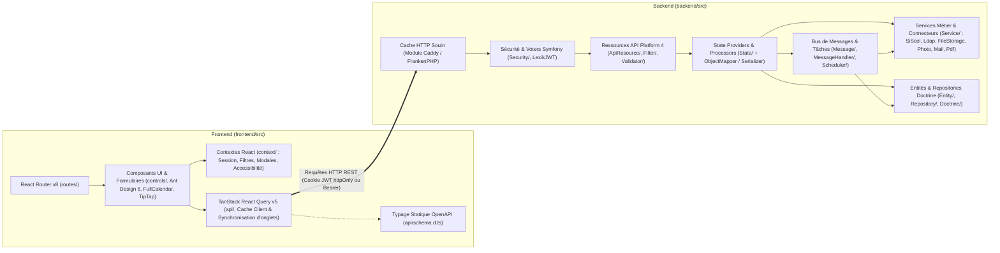
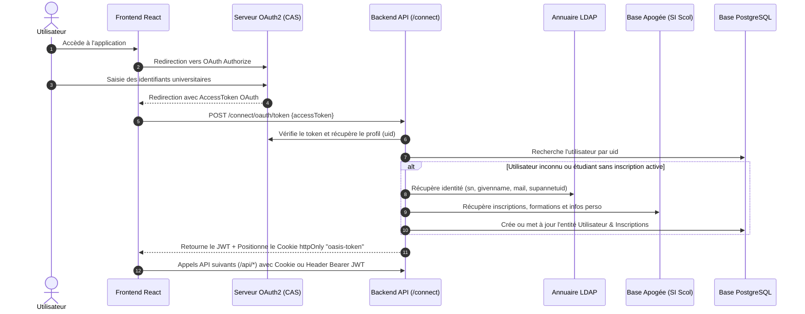
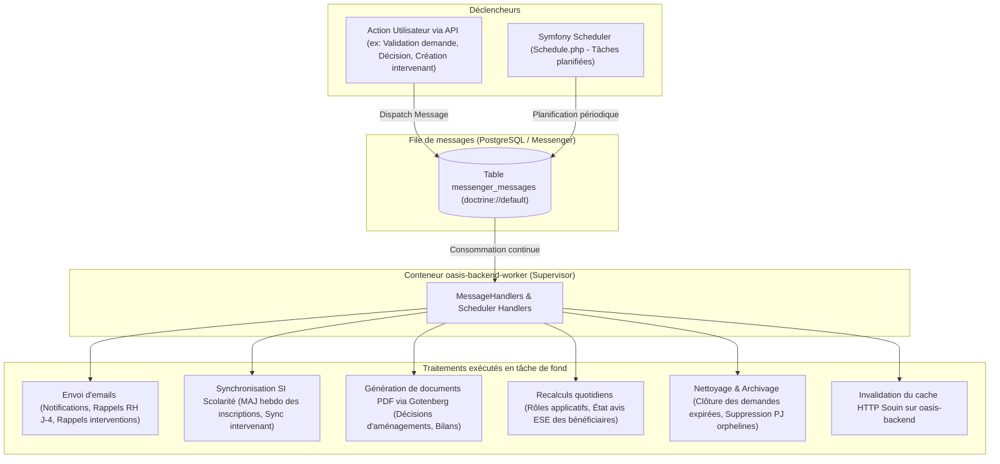

# Architecture de l'application ESUP-Oasis

**ESUP-Oasis** (*Outil pour l’Accompagnement et le Suivi Individualisé des étudiants à besoins Spécifiques*) repose sur une architecture découplée **Frontend SPA / Backend API REST**, complétée par un **Worker asynchrone** et fortement intégrée au Système d'Information (SI) de l'établissement.

---

## 1. Vue d'ensemble (Infrastructure & Intégrations SI)

Ce schéma présente les conteneurs de l'application (tels que définis dans [`installation/compose.yaml`](../installation/compose.yaml)), les services techniques compagnons et les connecteurs vers le SI de l'université.

```mermaid
flowchart TB
    subgraph Clients["Utilisateurs & Clients"]
        Browser["Navigateur Web (Étudiants, Gestionnaires, Intervenants, Commissions)"]
        ExtApp["Application Tiers (ex: Sync Calendrier via API Key)"]
    end

    subgraph Proxy["Point d'entrée"]
        Caddy["Reverse Proxy Caddy (HTTPS / TLS)"]
    end

    subgraph Oasis["Cœur Applicatif ESUP-Oasis"]
        Front["Frontend SPA (React 19, TypeScript, Vite, Ant Design)"]
        
        subgraph BackCluster["Backend (PHP 8.4 / Symfony 8.1)"]
            BackWeb["oasis-backend (FrankenPHP + Cache HTTP Souin + API Platform 4)"]
            BackWorker["oasis-backend-worker (Supervisor : Messenger & Scheduler)"]
        end
        
        DB[("PostgreSQL 15+ (Données Oasis & File Messenger)")]
    end

    subgraph TechServices["Services Techniques Internes"]
        Gotenberg["Gotenberg 8 (Génération PDF depuis HTML/Twig)"]
        ClamAV["ClamAV (Scan antivirus des pièces justificatives)"]
        LocalFS[("Stockage Fichiers Local (Volume / Disque)")]
    end

    subgraph SI["Système d'Information Établissement (Externe)"]
        CAS["Serveur OAuth2 / CAS (Authentification)"]
        LDAP["Annuaire LDAP (Référentiel Individus)"]
        SiScol[("SI Scolarité - Oracle Apogée / Custom (Inscriptions & Formations)")]
        Nuxeo["GED Nuxeo (Stockage PJ optionnel)"]
        Unicampus[("Base Unicampus Oracle/PG (Photos étudiants - optionnel)")]
        SMTP["Serveur SMTP (Envoi de courriels / Mailhog en dev)"]
    end

    %% Flux Clients -> Proxy -> Apps
    Browser -->|"HTTPS (/*)"| Caddy
    Browser -.->|"Redirection OAuth2"| CAS
    ExtApp -->|"HTTPS (/api/*)"| Caddy
    Caddy -->|"/* (Assets statiques)"| Front
    Caddy -->|"/api/* (REST / JSON-LD)"| BackWeb

    %% Flux Backend <-> DB & Worker
    BackWeb -->|"Doctrine ORM"| DB
    BackWorker -->|"Doctrine ORM & Consommation Queue"| DB
    BackWorker -->|"Purge du cache HTTP (Port 2019)"| BackWeb

    %% Flux Services Techniques
    BackWeb -->|"Scan à l'upload (TCP 3310)"| ClamAV
    BackWeb -->|"Conversion HTML -> PDF (HTTP 3000)"| Gotenberg
    BackWorker -->|"Conversion HTML -> PDF"| Gotenberg
    BackWeb -->|"Lecture / Écriture PJ"| LocalFS
    BackWorker -->|"Nettoyage PJ orphelines"| LocalFS

    %% Flux SI Externe
    BackWeb -->|"Vérification AccessToken (/connect/oauth/token)"| CAS
    BackWeb -->|"Recherche & Profils (LDAPS)"| LDAP
    BackWeb -->|"Lecture inscriptions & infos (OCI8 / Custom)"| SiScol
    BackWorker -->|"MAJ périodique inscriptions"| SiScol
    BackWeb -.->|"API REST (si activé)"| Nuxeo
    BackWorker -.->|"Nettoyage PJ (si activé)"| Nuxeo
    BackWeb -.->|"Récupération photos"| Unicampus
    BackWorker -->|"Envoi asynchrone de mails"| SMTP
```

> [!NOTE]
> Les clés de signature JWT (`config/jwt`) sont partagées via un volume Docker ([`installation/compose.yaml`](../installation/compose.yaml)) afin de permettre le passage à l'échelle horizontal du conteneur `oasis-backend`.

---

## 2. Architecture Logicielle Interne (Frontend & Backend)

Ce diagramme détaille l'organisation interne du code source entre [`frontend/src`](../frontend/src) et [`backend/src`](../backend/src).

### Points clés de l'architecture logicielle :
- **Découplage Modèle API / Modèle de persistance** : Le backend sépare les ressources exposées dans [`backend/src/ApiResource`](../backend/src/ApiResource) des entités Doctrine dans [`backend/src/Entity`](../backend/src/Entity). La transformation et la logique de lecture/écriture transitent par les **State Providers** et **State Processors** situés dans [`backend/src/State`](../backend/src/State) (sous-domaines métier : `Demande`, `Amenagement`, `Evenement`, `DecisionAmenagementExamens`, `Utilisateur`, etc.).
- **Abstraction des connecteurs externes** ([`docs/backend/connecteurs.md`](backend/connecteurs.md)) :
  - **Scolarité** : Basé sur [`AbstractSiScolDataProvider`](../backend/src/Service/SiScol/AbstractSiScolDataProvider.php) permettant de brancher Apogée ou un autre SI (ex. Pégase).
  - **Stockage de fichiers** : Basé sur `StorageProviderInterface` (implémentations locale ou Nuxeo, voir [`docs/backend/pieces_justificatives.md`](backend/pieces_justificatives.md)).
  - **Photos** : Basé sur `PhotoProviderInterface` (implémentation Unicampus ou locale).

---

## 3. Flux d'Authentification (OAuth2 / CAS vers JWT)

L'authentification s'appuie sur un serveur OAuth2 (typiquement CAS) couplé à l'annuaire LDAP et à l'émission d'un token JWT (documenté dans [`docs/backend/auth.md`](backend/auth.md)).

---

## 4. Architecture des Traitements Asynchrones et Planifiés

Le conteneur `oasis-backend-worker` (défini par [`backend/Dockerfile-worker`](../backend/Dockerfile-worker) et documenté dans [`docs/backend/traitements_asynchrones.md`](backend/traitements_asynchrones.md)) exécute **Supervisor** pour consommer les messages Symfony Messenger et les tâches planifiées Symfony Scheduler ([`backend/src/Schedule.php`](../backend/src/Schedule.php)).

